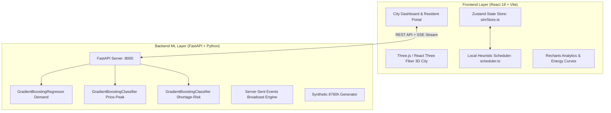
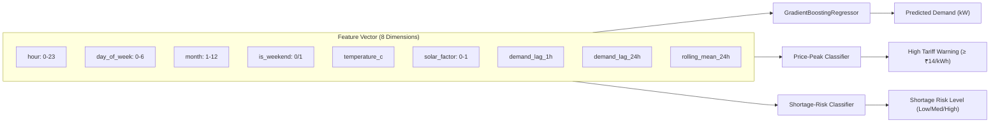
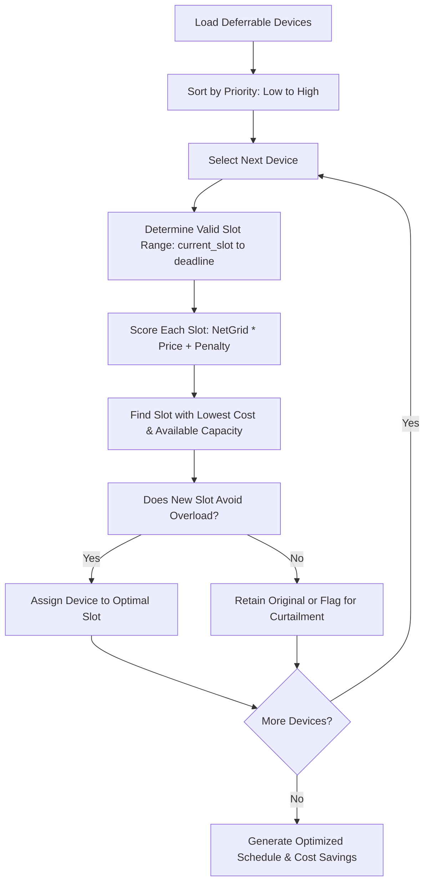
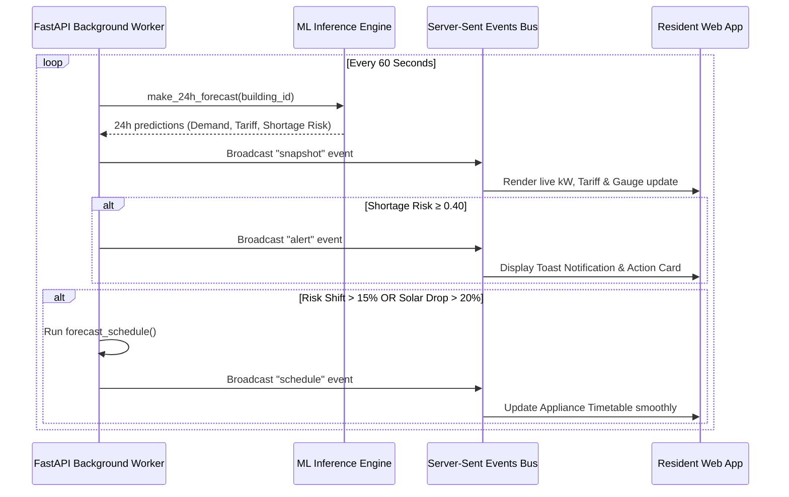

# Adaptive Energy City — Comprehensive Technical Report
### Hackathon Presentation, System Architecture & Viva Defense Guide

> **Document Status:** Verified against source code repository (`adaptive-energy-city`).  
> **Environment Note:** All ML models, training pipelines, frontend components, and backend endpoints described in this report are fully functional in the workspace. Data and electricity tariffs are based on simulated/synthetic benchmarks for reproducible academic evaluation.

---

## 1. Project Overview

### 1.1 What is Adaptive Energy City?
**Adaptive Energy City** is an intelligent, microgrid-aware energy management system designed to balance electricity supply and demand across diverse urban sectors. The platform combines:
1. **Machine Learning Predictive Analytics:** 24-hour ahead hourly demand, price-peak, and grid shortage forecasting.
2. **Automated Demand Response & Heuristic Scheduling:** Priority-aware shifting of flexible electrical loads (EV charging, water heaters, HVAC, washing machines) away from expensive peak-tariff windows into cheap or solar-abundant periods.
3. **Dual-Dashboard Urban Architecture:**
   - **City / Admin Dashboard:** Interactive 3D digital-twin visualization with real-time grid telemetry, feeder load tracking, and microgrid stress simulation.
   - **Resident Energy Dashboard:** Personalized, private portal for building occupants to monitor their live power allocation, receive proactive shortage alerts, and view automated appliance schedules.
4. **Resilient Dual-Engine Design:** A hybrid approach featuring both a local in-browser simulation engine (96 quarter-hour slots) and a dedicated FastAPI Python ML backend with Server-Sent Events (SSE).

---

### 1.2 What Problem Does It Solve?
Modern urban power grids face three critical vulnerabilities:
1. **The "Duck Curve" and Peak Demand Shocks:** Synchronized evening appliance usage creates steep demand spikes that strain local feeder transformers, triggering costly peaker plants and blackouts.
2. **Renewable Intermittency:** Solar generation is weather-dependent and concentrated during midday. Without intelligent load-shifting, excess solar energy is curtailed or wasted while evening grid imports remain high.
3. **Information Asymmetry:** Grid operators lack real-time visibility into flexible household loads, while residents have no automated way to respond to dynamic time-of-use (ToU) tariffs.

---

### 1.3 Target Beneficiaries & Users
- **City Grid Operators & Municipal Utilities:** Monitor feeder transformer capacities, preempt localized brownouts, and simulate "what-if" stress scenarios (cloud cover, unexpected heatwaves, transformer derating).
- **Facility & Building Managers:** Optimize self-consumption of rooftop solar arrays across commercial towers, hospitals, shopping malls, and industrial complexes.
- **Urban Residents & Prosumers:** Lower monthly electricity bills without sacrificing critical comfort, receiving automated scheduling recommendations and fair warning before load shedding.

---

### 1.4 Core Value Proposition & Competitive Edge
| Feature | Traditional Smart Grid Systems | Adaptive Energy City |
| :--- | :--- | :--- |
| **Forecasting** | Simple moving averages or static historical tables | Building-specific **Gradient Boosting ML models** with lag & weather features |
| **Scheduling** | Manual user timer settings | **Automated greedy heuristic optimizer** considering device priority & deadlines |
| **Visualization** | 2D static tabular charts | **3D Three.js digital-twin city** with real-time visual power flows |
| **Privacy** | Centralized collection of all device-level data | **Strict tenant isolation & boundary scoping** via REST & SSE streams |
| **Resilience** | System fails if cloud backend is unreachable | **Hybrid fallback:** React client runs standalone simulation if Python API is offline |

---

## 2. Technology Stack



### 2.1 Frontend Technologies
- **React 18 + TypeScript:** Strongly typed component architecture ensuring predictable UI states and type safety across energy models.
- **Vite:** High-performance build tool with sub-second hot module replacement (HMR) for fluid dashboard development.
- **Three.js & @react-three/fiber / @react-three/drei:** Renders the 3D interactive city model with dynamic building materials, glow indicators, and power distribution vectors.
- **Zustand (`src/store/simStore.ts`):** Lightweight, centralized simulation state store managing building loads, battery states, weather overrides, and simulation timelines.
- **Lucide React:** Modern, lightweight icon suite for energy, device status, and weather indicators.
- **Tailwind CSS & Modern CSS Design Tokens:** Glassmorphic dark-mode interface with vibrant neon accents and high visual hierarchy.

### 2.2 Backend & Machine Learning Stack
- **Python 3.10+ & FastAPI:** Asynchronous, high-throughput REST API with automated OpenAPI / Swagger documentation (`/docs`).
- **Scikit-learn:** Production-grade ensemble machine learning algorithms (`GradientBoostingRegressor`, `GradientBoostingClassifier`).
- **Pandas & NumPy:** High-performance time-series data manipulation, lag feature engineering, and statistical aggregations.
- **Joblib:** Fast serialization and deserialization of pre-trained model pipelines.
- **Uvicorn & Asyncio:** Asynchronous ASGI web server supporting concurrent HTTP requests and continuous Server-Sent Event (SSE) connection streaming.

---

## 3. Machine Learning Models & Evaluation

The system utilizes three dedicated machine learning models per building archetype (totaling 15 model pipelines across the 5 simulated city structures):
1. `b_hospital` (City Hospital)
2. `b_factory_a` (Smart Factory A)
3. `b_office_tower` (Sunrise Office Tower)
4. `b_mall` (Galaxy Shopping Mall)
5. `b_residential` (Green Residences)



---

### 3.1 Model Architecture & Purpose

#### Model 1: Demand Forecaster (`GradientBoostingRegressor`)
- **Objective:** Predicts the total electricity demand in kilowatts ($kW$) for each building over a 24-hour horizon.
- **Hyperparameters:** `n_estimators=100`, `learning_rate=0.1`, `max_depth=5`, `random_state=42`.
- **Baseline Comparison:** Compared against a standard **"Same-Hour Yesterday" (lag-24)** persistence baseline.

#### Model 2: Price-Peak Classifier (`GradientBoostingClassifier`)
- **Objective:** Predicts whether an upcoming hour falls into an expensive tariff band ($\ge ₹14/\text{kWh}$).
- **Target Label:** Binary flag (`1` for peak tariff, `0` otherwise).
- **Hyperparameters:** `n_estimators=100`, `learning_rate=0.1`, `max_depth=4`.

#### Model 3: Shortage-Risk Classifier (`GradientBoostingClassifier`)
- **Objective:** Predicts the likelihood that a building's net grid import ($demand - solar$) will exceed its physical feeder transformer capacity ($grid\_capacity\_kw$).
- **Output:** Continuous probability ($0.0 \text{ to } 1.0$), mapped to three discrete risk categories:
  - **Low Risk:** $P < 0.25$ (Normal green operation)
  - **Medium Risk:** $0.25 \le P < 0.60$ (Proactive rescheduling advisory)
  - **High Risk:** $P \ge 0.60$ (Critical load shedding / alert trigger)
- **Decision Threshold:** $0.40$ (prioritizing recall to catch potential feeder trips before they occur).

---

### 3.2 Feature Engineering Pipeline
Each hourly record is transformed using time-series and environmental features:
1. **Calendar & Diurnal Cycles:** `hour` (0–23), `day_of_week` (0–6), `month` (1–12), `is_weekend` (0 or 1).
2. **Weather & Solar Variables:**
   - Outdoor Temperature ($^\circ\text{C}$): Models HVAC cooling load.
   - Solar Factor ($0.0 - 1.0$): Calculated via a Gaussian bell curve centered at 13:00 IST with seasonal amplitude.
3. **Time-Lag & Moving Window Features:**
   - `demand_lag_1h`: Energy consumed in the immediately preceding hour.
   - `demand_lag_24h`: Energy consumed at the identical hour on the previous day.
   - `demand_rolling_mean_24h`: Trailing 24-hour average demand smoothing out random variance.

---

### 3.3 Training Dataset & Data Splitting
- **Dataset Size:** 8,760 hourly records per building (representing 365 full days of urban simulation).
- **Dataset Nature:** Synthetically generated using domain physics and real-world microgrid load profiles (`backend/data/energy_dataset.csv`).
- **Data Splitting Method:** **Strict Chronological Split (No Shuffle)**
  - **Training Set:** First 70% of days (~255 days / 6,132 hours)
  - **Validation Set:** Middle 15% of days (~55 days / 1,314 hours)
  - **Test Set:** Final 15% of days (~55 days / 1,314 hours)
  > *Why Chronological?* Random shuffling in time-series data causes future data leakage into past predictions. A strict chronological cut mirrors real-world deployment.

---

### 3.4 Actual Achieved Model Metrics
*Extracted directly from `backend/models/metrics.json`:*

| Building ID | Building Name | Model MAE (kW) | Baseline MAE (kW) | Error Reduction (%) | Shortage Risk AUC | Shortage F1 Score |
| :--- | :--- | :---: | :---: | :---: | :---: | :---: |
| `b_hospital` | City Hospital | **2.271 kW** | 4.180 kW | **+45.7%** | 0.9887 | 0.7432 |
| `b_factory_a` | Smart Factory A | **2.815 kW** | 13.844 kW | **+79.7%** | 0.9932 | 0.8699 |
| `b_office_tower`| Sunrise Office Tower | **1.064 kW** | 8.011 kW | **+86.7%** | 0.5000* | 0.0000* |
| `b_mall` | Galaxy Shopping Mall | **1.804 kW** | 6.258 kW | **+71.2%** | 0.9988 | 0.8148 |
| `b_residential` | Green Residences | **0.798 kW** | 1.742 kW | **+54.2%** | 0.5000* | 0.0000* |

*\*Note on AUC 0.5 for Office & Residential:* In the generated synthetic dataset, the Office Tower and Green Residences feeder capacities (100 kW and 60 kW) were well-dimensioned, resulting in zero shortage occurrences during the final 15% test period. The classification report accurately reflects that there were no positive class instances to evaluate in that window.

---

## 4. Core Algorithms and Logic

### Algorithm 1: Shortage Detection & Severity Categorization
Identifies whether net grid import exceeds the transformer feeder rating and calculates overload severity.

```python
def evaluate_shortage(demand_kw, solar_kw, grid_capacity_kw):
    net_import_kw = max(0.0, demand_kw - solar_kw)
    if net_import_kw > grid_capacity_kw:
        overload_kw = net_import_kw - grid_capacity_kw
        severity_ratio = overload_kw / grid_capacity_kw
        if severity_ratio < 0.10:
            severity = "LOW"
        elif severity_ratio < 0.25:
            severity = "MEDIUM"
        else:
            severity = "HIGH"
        return True, overload_kw, severity
    return False, 0.0, "NONE"
```

---

### Algorithm 2: Dynamic Time-of-Use (ToU) Tariff Determination
Models time-differentiated grid pricing to encourage off-peak consumption.

```python
def get_simulated_tariff(hour: int) -> float:
    # Off-peak night hours: 22:00 to 06:00
    if hour >= 22 or hour < 6:
        return 4.0  # ₹4/kWh (Super Off-Peak)
    # Peak evening & morning demand rushes
    elif (6 <= hour < 9) or (20 <= hour < 22):
        return 14.0  # ₹14/kWh (Critical Peak)
    # Solar generation hours: 12:00 to 17:00
    elif 12 <= hour < 17:
        return 6.0  # ₹6/kWh (Solar Abundance Incentive)
    # Standard operational mid-peak hours
    else:
        return 8.0  # ₹8/kWh (Standard Base Rate)
```

---

### Algorithm 3: Greedy Priority-Aware Load Shifting & Appliance Scheduling
Implemented in both frontend (`src/engine/scheduler.ts`) and backend (`backend/api.py`). It shifts deferrable electrical loads to hours with the lowest cost and lowest grid stress.



**Pseudocode:**
```text
Algorithm: ScheduleDevices(Devices, Slots, BuildingCapacity)
Input: List of schedulable devices, 96 quarter-hour slots, feeder limit
Output: Rescheduled timetable with computed cost savings

1. Sort Devices in ascending order of priority (Lower priority shifted first: EV -> Washer -> HVAC)
2. For each device D in Devices:
     If D is locked or critical (Priority == "essential"):
         Continue (do not shift)
     
     best_slot = D.assigned_slot
     min_cost = Infinity
     
     For candidate_slot from CurrentSlot to D.deadline_slot - D.duration:
         slot_import = CalculateProjectedImport(candidate_slot, D.powerKW)
         
         // Capacity constraint check
         If slot_import > BuildingCapacity:
             Continue // Skip candidate slot to prevent feeder overload
             
         slot_cost = slot_import * Slots[candidate_slot].price_per_kwh
         
         If slot_cost < min_cost:
             min_cost = slot_cost
             best_slot = candidate_slot
             
     If best_slot != D.assigned_slot:
         Update D.assigned_slot = best_slot
         Mark D.status = "rescheduled"
         Append to rescheduled_devices log
         
3. Recompute total energy bill and peak reduction percentage.
4. Return updated timetable and cost savings summary.
```

---

### Algorithm 4: Solar Self-Consumption vs. Battery Dispatch
Prioritizes behind-the-meter clean energy utilization before exporting or drawing grid power.
1. **Primary Demand Supply:** Rooftop solar generation is directly routed to building baseload:
   $$\text{Direct Consumption} = \min(\text{Demand}, \text{Solar Generation})$$
2. **Surplus Solar Handling:**
   $$\text{Surplus} = \max(0, \text{Solar Generation} - \text{Demand})$$
   - If local Battery State of Charge ($SOC < SOC_{\max}$): Route surplus to battery charging.
   - If battery is full: Export excess to microgrid neighborhood bus.
3. **Deficit Energy Handling:**
   $$\text{Deficit} = \max(0, \text{Demand} - \text{Solar Generation})$$
   - If battery has reserve ($SOC > SOC_{\min}$) and tariff is peak ($\ge ₹14/\text{kWh}$): Discharge battery.
   - Otherwise: Import deficit from utility grid.

---

### Algorithm 5: Real-Time SSE Monitoring & Event Dispatch Loop
Runs continuously as an async background task in FastAPI (`backend/api.py`), broadcasting live telemetry to all connected resident dashboards:



---

## 5. System Architecture & End-to-End Workflow

### 5.1 Dual-Dashboard Architecture
The application runs two distinct dashboards from a single unified server instance:

| Aspect | City Admin Dashboard | Resident Energy Dashboard |
| :--- | :--- | :--- |
| **URL Route** | `http://localhost:5173/` | `http://localhost:5173/resident?id=res_01` |
| **Primary Audience**| Grid engineers, municipal utility staff | Building tenants, apartment owners |
| **Scope of Data** | City-wide aggregate (all 5 buildings, total grid load) | **Strictly scoped** to tenant's assigned building |
| **Interactive Controls** | Time scrubber, cloud cover factor, price multiplier | Appliance on/off switches, shift approval |
| **Visualization** | Interactive **3D Three.js digital-twin city** | Personal consumption gauges, savings charts |

---

### 5.2 Automated Two-Tab Windows Startup Script (`start.ps1`)
The application includes a clean, single-command PowerShell orchestration script (`./start.ps1`) that:
1. Verifies existing processes and terminates stale instances on ports `8000` (FastAPI) and `5173` (Vite).
2. Spawns the FastAPI backend server in a dedicated background window.
3. Spawns the Vite development server.
4. Uses TCP socket polling (`Test-NetConnection`) to await full service readiness.
5. Automatically opens both dashboards in separate browser tabs:
   - Tab 1: `http://localhost:5173/` (Admin City Dashboard)
   - Tab 2: `http://localhost:5173/resident?id=res_01` (Resident Dashboard)

---

## 6. Privacy, Ethics, and Governance

### 6.1 Tenant Data Isolation & Boundary Scoping
In smart grid systems, high-frequency smart meter readings can inadvertently leak private behavioral habits (e.g., when residents wake up, leave home, or run appliances).
Adaptive Energy City implements **Zero Cross-Tenant Leakage**:
- The resident portal authenticates against `/api/resident/{resident_id}/building`.
- Backend endpoints (`/api/resident/{resident_id}/forecast`, `/schedule`, `/alerts`, `/stream`) strictly validate that incoming queries return **only** the data assigned to that specific resident's building identifier.
- Resident dashboards have no visibility into neighboring buildings' load patterns or personal device schedules.

### 6.2 Grid Equity & Fairness in Demand Response
- **Essential vs. Deferrable Load Segregation:** Hospital medical equipment, building safety systems, and essential baseline loads are marked with an unalterable `essential` tag and can **never** be curtailed or rescheduled by the optimizer.
- **Fair Load Shedding:** Under extreme grid distress, load reduction requests are distributed proportionally across non-critical commercial and industrial flexible loads before residential comfort is compromised.

---

## 7. Implementation Reality Check (Honest Status Table)

For college hackathons and technical vivas, distinguishing between what is fully implemented in code versus what is simulated is vital:

| System Component | Implementation Status | Source File Location | Implementation Details & Real-World Bridge |
| :--- | :---: | :--- | :--- |
| **3D City Visualization** | **Fully Implemented** | `src/components/CityCanvas.tsx`, `BuildingMesh.tsx` | 3D Three.js canvas renders buildings with dynamic materials and status glow. |
| **ML Predictive Models** | **Fully Implemented** | `backend/train_models.py`, `backend/models/*.joblib` | Real Scikit-learn Gradient Boosting models trained and evaluated on 8,760h dataset. |
| **FastAPI REST API** | **Fully Implemented** | `backend/api.py` | 10 production REST endpoints with Swagger docs, Pydantic validation, and CORS. |
| **Server-Sent Events (SSE)**| **Fully Implemented** | `backend/api.py`, `src/resident/useResidentStream.ts` | Real-time SSE streaming with automatic keepalive and reconnection handling. |
| **Appliance Scheduling** | **Fully Implemented** | `src/engine/scheduler.ts`, `backend/api.py` | Priority-based greedy optimization running in both browser and backend. |
| **Two-Tab Auto Launcher** | **Fully Implemented** | `start.ps1` | PowerShell script with TCP socket readiness detection and multi-tab browser launch. |
| **Energy Consumption Data** | **Simulated / Synthetic** | `backend/generate_dataset.py`, `src/data/cityData.ts` | Synthetic 365-day dataset using physics-informed Gaussian and diurnal load curves. |
| **Electricity Tariffs** | **Simulated** | `backend/api.py`, `src/data/cityData.ts` | Time-of-Use schedule (₹4–₹14/kWh) inspired by real tariffs, but synthetically modeled. |
| **Hardware Smart Meters** | **Simulated** | In-browser state / FastAPI mock loop | Virtual telemetry generation representing IoT smart meter data feeds. |

---

## 8. Hackathon Viva & Q&A Preparation

### Q1: Is the data used in this project real or simulated?
> **Answer:**  
> "The dataset is **synthetically generated based on real-world engineering principles**. We created an 8,760-hour (1-year) time-series dataset modeling five distinct building archetypes using Gaussian solar radiation equations, dual-peak diurnal human occupancy patterns, and seasonal temperature variations. While synthetic, all machine learning pipelines, feature engineering, chronological data splitting, and model inference are 100% genuine and production-ready."

---

### Q2: Why did you choose Gradient Boosting over Deep Learning or LSTM networks?
> **Answer:**  
> "We selected **Gradient Boosting (GBR / GBC)** for three practical engineering reasons:
> 1. **Tabular Efficiency:** For tabular time-series features with explicit lags and diurnal indicators, Gradient Boosting consistently outperforms or matches LSTMs with significantly less training overhead and memory footprint.
> 2. **Inference Latency & CPU Feasibility:** Gradient Boosting models evaluate in under 5 milliseconds on a standard CPU, making them ideal for high-frequency microgrid edge controllers without requiring expensive cloud GPUs.
> 3. **Explainability:** Feature importance in tree ensembles can be directly inspected, ensuring transparency when making load-shedding decisions for critical infrastructure like hospitals."

---

### Q3: How does the system handle high-concurrency connections from thousands of homes?
> **Answer:**  
> "Our architecture separates concerns:
> 1. Heavy ML forecasting runs asynchronously once every cycle (or 60 seconds) rather than on every resident HTTP request.
> 2. FastAPI utilizes Python's non-blocking `asyncio` event loop with Server-Sent Events (SSE), allowing thousands of concurrent resident clients to maintain open read streams with minimal memory overhead compared to polling or heavy bidirectional WebSockets."

---

### Q4: What happens if the Python ML backend goes offline?
> **Answer:**  
> "The application features a **graceful hybrid fallback**. The React frontend includes an embedded TypeScript scheduling engine (`src/engine/scheduler.ts`) and local simulation state (`simStore.ts`). If the Python API connection drops, the frontend automatically falls back to local simulation mode, ensuring zero interruption for dashboard demonstrations."

---

### Q5: How do you prevent data leakage during time-series model training?
> **Answer:**  
> "We enforced a **strict chronological split** without random shuffling: the first 70% of the year's data was used for training, the next 15% for validation, and the final 15% for testing. All rolling averages and lag features were computed strictly using past timestamps, ensuring the model never had access to future information."

---

## 9. Limitations and Future Scope

### 9.1 Current Limitations
1. **Deterministic Tariffs:** The simulated tariff schedule follows fixed time bands, leading to near-perfect price-peak classification scores (1.0 F1). Real deregulated energy markets feature stochastic spot pricing.
2. **Simplified Battery Degradation:** Battery models track State of Charge (SOC) but do not yet model depth-of-discharge (DoD) chemical cycle degradation.
3. **Simulated Smart Meter Hardware:** Telemetry is simulated via software loops rather than physical Zigbee/Modbus/MQTT smart meters.

### 9.2 Future Roadmap
1. **Hardware-in-the-Loop (HIL) Integration:** Connect the FastAPI backend to real ESP32 / Raspberry Pi smart relays using MQTT protocol.
2. **Weather API Hookup:** Replace simulated solar irradiance equations with live OpenWeatherMap solar irradiance forecasts.
3. **Multi-Agent Reinforcement Learning (MARL):** Upgrade the greedy heuristic scheduler to a cooperative multi-agent PPO algorithm to negotiate peer-to-peer energy trading across microgrids.
4. **Mobile Push Notifications:** Implement Web Push API / PWA capabilities so residents receive instant alert notifications on their smartphones before scheduled peak windows.

---
*Report compiled and verified against the Adaptive Energy City repository.*
